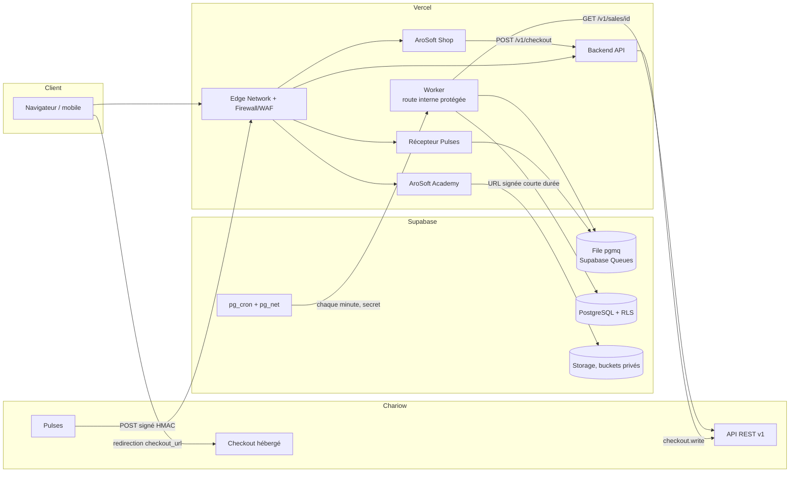
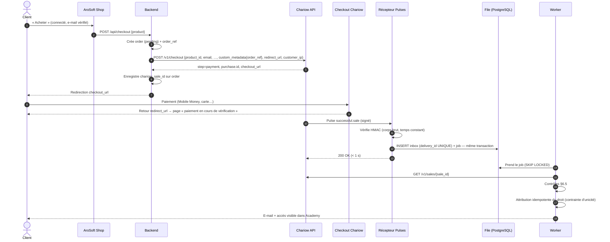
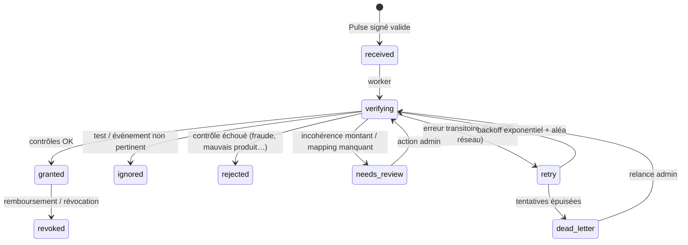

# AroSoft — Document d'architecture

> **Statut : PROPOSITION — en attente de relecture finale. Aucune implémentation n'a commencé.**
> Version 0.3 — 12/11/2026 — Intègre l'extension « WhatsApp, cybersécurité et Chariow » et les
> décisions du questionnaire de cadrage (§0).
>
> Ce document est la référence du projet (pas de cahier des charges initial à intégrer).

## 0. Décisions validées (questionnaire du 12/11/2026)

| Sujet | Décision |
|---|---|
| Référence | Ce document fait foi ; pas de cahier initial à intégrer. |
| Pile | TypeScript + Next.js + PostgreSQL. |
| Hébergement | **Vercel** (Shop, Academy, API) + **Supabase** (PostgreSQL, Auth, Storage). |
| Academy | **Construite dans ce projet**, héberge elle-même les contenus. |
| Achat | **Checkout via l'API Chariow** (`POST /v1/checkout`) ; téléphone de l'acheteur collecté. |
| Remboursements | Détection automatique par rapprochement (< 24 h) **et** révocation manuelle immédiate par un admin. |
| Historique | Import de tous les achats Chariow + **e-mail d'invitation** aux clients importés. |
| Reprise | **RPO 15 min / RTO 4 h** (impose la sauvegarde continue PITR de Supabase). |
| Alertes | **E-mail et WhatsApp**. |

---

## Sommaire

0. [Décisions validées](#0-décisions-validées-questionnaire-du-12112026)
1. [Périmètre et principes](#1-périmètre-et-principes)
2. [Vue d'ensemble](#2-vue-densemble)
3. [Pile technique](#3-pile-technique)
4. [Module A — Support WhatsApp](#4-module-a--support-whatsapp)
5. [Module B — Sécurité applicative](#5-module-b--sécurité-applicative)
6. [Module C — Intégration Chariow](#6-module-c--intégration-chariow)
7. [Modèle de données](#7-modèle-de-données)
8. [Exploitation : sauvegardes, journalisation, incidents](#8-exploitation--sauvegardes-journalisation-incidents)
9. [Traçabilité des critères de validation](#9-traçabilité-des-critères-de-validation)
10. [Points ouverts](#10-points-ouverts)

---

## 1. Périmètre et principes

Deux applications partagent un même backend :

| Application | Rôle |
|---|---|
| **AroSoft Shop** | Vitrine et catalogue public, lancement du paiement via Chariow. |
| **AroSoft Academy** | Espace élève privé : contenus (cours, fichiers) accessibles uniquement avec un droit d'accès valide. |
| **Backend AroSoft** | API, authentification, droits d'accès, intégration Chariow, administration. |

Principes directeurs :

- **Sécurité dès la conception** : référentiel **OWASP ASVS 5.0, niveau 2** (niveau 3 visé pour les flux de paiement et l'administration).
- **Refus par défaut** : aucune ressource privée n'est servie sans contrôle d'autorisation côté serveur.
- **Le Backend décide seul des droits** : ni le navigateur, ni un Pulse, ni une métadonnée produit modifiable ne suffisent à accorder un accès.
- **Aucune vente perdue** : chaque événement est d'abord enregistré durablement, puis traité ; un rapprochement périodique rattrape tout ce qui a été manqué.
- **Configuration sans redéploiement** : les paramètres métier (WhatsApp, correspondances produits) vivent en base, pas dans le code.

## 2. Vue d'ensemble



Flux de vente cible (exigence C) :

```
AroSoft Shop → Checkout Chariow → Pulse de vente → Backend AroSoft
            → Vérification API → Attribution du droit → AroSoft Academy
```

## 3. Pile technique

| Couche | Choix | Justification / précautions |
|---|---|---|
| Langage | TypeScript (Node.js LTS) | Un seul langage pour Shop, Academy et Backend. |
| Application | **Next.js (App Router) sur Vercel**, rendu serveur, Route Handlers pour l'API | Shop indexable, Academy protégée côté serveur, CSP à nonce via middleware. Runtime Node.js (pas Edge) pour les routes qui manipulent crypto/HMAC et la base. |
| Validation | Zod (schémas partagés) | Entrées, réponses de l'API Chariow et payloads Pulse. |
| Base de données | **Supabase PostgreSQL**, accès serveur via Drizzle (requêtes paramétrées) + pooler Supavisor (mode transaction) adapté au sans-serveur | Contraintes d'unicité, transactions ; **RLS activée sur toutes les tables** exposées. |
| Authentification | **Supabase Auth utilisé uniquement côté serveur** (`@supabase/ssr`) | E-mail vérifié obligatoire ; MFA TOTP avec exigence du niveau `aal2` pour les rôles admin (contrôlée dans l'application **et** dans les politiques RLS). Cookies de session forcés `HttpOnly`, `Secure`, `SameSite` ; pas de session Supabase côté navigateur. Clé `service_role` réservée aux routes serveur et workers, jamais exposée. |
| File d'événements | **Supabase Queues (pgmq)** | Vercel n'exécute pas de processus permanents : la file vit dans PostgreSQL. Le Pulse et son message de file sont enregistrés **dans la même transaction**. |
| Workers | Route interne Vercel `/api/internal/worker` déclenchée **chaque minute par `pg_cron` + `pg_net`** (en-tête secret, vérifié en temps constant), plus une tentative immédiate juste après la réception du Pulse (`after()` de Next.js) | Chaque exécution traite un lot borné dans la durée maximale d'une fonction Vercel ; un message non acquitté redevient visible (délai de visibilité pgmq) et sera repris. |
| Tâches planifiées | `pg_cron` (rapprochements, catalogue, santé des Pulses, purge) | Indépendant des limites de cron du plan Vercel. |
| Stockage des ressources | **Supabase Storage, buckets privés** | URL signées de quelques minutes, délivrées après contrôle du droit. Vidéos volumineuses : voir §10. |
| Secrets | Variables d'environnement chiffrées Vercel (marquées *Sensitive*) + secrets Supabase | Jamais dans le dépôt ; une valeur par environnement. |
| Edge / WAF | **Vercel Firewall** (règles WAF gérées, règles personnalisées, limitation de débit, protection DDoS) | Remplace Cloudflare dans ce schéma (un proxy devant Vercel est déconseillé par Vercel). |
| E-mails | Fournisseur transactionnel (ex. Resend), domaine authentifié SPF/DKIM/DMARC | Vérification d'e-mail, invitations des clients importés, alertes. |
| Observabilité | Logs JSON structurés (Vercel Log Drains vers un agrégateur) + alertes | Masquage systématique des données sensibles. |

**Plans requis :** Vercel **Pro** (durée des fonctions, règles Firewall, Log Drains) et Supabase **Pro + option PITR** (RPO 15 min). À confirmer avec le budget (§10).

## 4. Module A — Support WhatsApp

### 4.1 Fonctionnement

Un bouton flottant présent sur **Shop et Academy** ouvre une conversation WhatsApp au format officiel :

```
https://wa.me/<numéro au format international, chiffres uniquement>?text=<message encodé>
```

- Numéro initial : `+2250584060606`, stocké en base sous la forme `2250584060606` (sans `+`, espaces ni tirets, exigence du format wa.me).
- Le message est encodé avec `encodeURIComponent` (UTF-8 ; accents, espaces, `&`, `?`, `#` et retours à la ligne correctement échappés).
- Le lien est un vrai `<a href>` avec `target="_blank" rel="noopener noreferrer"` : sur **Android**, wa.me ouvre l'application WhatsApp ; sur **ordinateur**, il ouvre WhatsApp Desktop ou WhatsApp Web. Aucun JavaScript n'est nécessaire pour que le lien fonctionne (compatibilité CSP stricte).

### 4.2 Paramètres généraux (administration)

Nouvelle section **Administration → Paramètres généraux → Support WhatsApp** :

| Paramètre | Type | Validation |
|---|---|---|
| `whatsapp.enabled` | booléen | — |
| `whatsapp.phone` | texte | Chiffres uniquement, format E.164 sans `+` : `^[1-9][0-9]{7,14}$`. Aperçu du lien et bouton « tester » avant enregistrement. |
| `whatsapp.greeting` | texte (≤ 500 car.) | Message d'accueil par défaut. |
| `whatsapp.position` | énum | `bottom-right` / `bottom-left`. |
| `whatsapp.offset` | entiers | Décalage en pixels (0 à 200), pour ne pas masquer d'autres éléments. |
| `whatsapp.display` | énum | `all` / `mobile` / `desktop`. |
| `whatsapp.scope` | ensemble | `shop`, `academy` (activable indépendamment). |
| `whatsapp.hidden_paths` | liste | Pages où masquer le bouton (ex. pages de paiement). |
| `whatsapp.label` | texte (≤ 40 car.) | Libellé / infobulle accessible (`aria-label`). |
| `whatsapp.product_template` | texte | Message contextuel par défaut pour les pages produit. |
| Surcharge par produit | texte (facultatif) | Champ « Message WhatsApp » sur la fiche produit, prioritaire sur le modèle par défaut. |

### 4.3 Messages contextuels et confidentialité

Les modèles n'acceptent qu'une **liste blanche de variables publiques** :

| Variable | Contenu |
|---|---|
| `{site}` | « AroSoft Shop » ou « AroSoft Academy » |
| `{produit}` | Nom public du produit |
| `{url_produit}` | URL publique canonique du produit |
| `{reference_produit}` | Référence publique (slug) |

Toute autre variable est **refusée à l'enregistrement**. Il est donc impossible techniquement d'insérer nom, e-mail, téléphone, numéro de commande, identifiant de session ou jeton du client dans un message prérempli. Le rendu se fait côté serveur à partir des seules données publiques du produit.

Priorité de résolution : surcharge produit → modèle produit global → message d'accueil.

### 4.4 Prise en compte sans redéploiement

- Paramètres stockés dans la table `site_settings` (versionnée, chaque modification est **journalisée** avec auteur et date).
- Lecture via une API publique en lecture seule `GET /api/public/settings/support`, qui n'expose **que** les champs publics.
- Cache applicatif de 60 s maximum, **invalidé immédiatement** à chaque modification ; les pages sont rendues côté serveur avec ces valeurs. Résultat : un changement de numéro est effectif en moins d'une minute, sans redéploiement.
- Seuls les rôles `admin` et `super_admin` (avec MFA) peuvent modifier ces paramètres.

## 5. Module B — Sécurité applicative

### 5.1 Référentiels

- **OWASP ASVS 5.0** comme référentiel de vérification (niveau 2 global, niveau 3 pour paiement, droits d'accès et administration). Une liste de contrôle ASVS est maintenue dans `docs/security/asvs-checklist.md` (livrable de la phase 1), chaque exigence étant reliée à un test ou à une preuve.
- **OWASP Top 10 (édition 2025)** : couverture résumée ci-dessous.

| Risque Top 10 2025 | Mesures principales |
|---|---|
| A01 Contrôle d'accès défaillant | Autorisation côté serveur sur chaque requête, filtrage systématique par propriétaire, tests IDOR automatisés (§5.3). |
| A02 Mauvaise configuration | En-têtes de sécurité, CSP stricte, configuration par environnement, aucun mode debug en production. |
| A03 Chaîne d'approvisionnement logicielle | Fichiers de verrouillage, analyse des dépendances en CI, Dependabot/Renovate, images minimales. |
| A04 Défaillances cryptographiques | TLS 1.2+ partout, HSTS, hachage des mots de passe par Supabase Auth, chiffrement des sauvegardes (`age`). |
| A05 Injection | Requêtes paramétrées exclusivement, validation Zod, encodage des sorties. |
| A06 Conception non sécurisée | Modélisation des menaces sur le flux de paiement (§6.9), Pulse jamais considéré comme preuve. |
| A07 Défaillances d'authentification | MFA administrateur, limitation de débit, verrouillage progressif, sessions sécurisées. |
| A08 Intégrité des logiciels et des données | Signature HMAC des Pulses, revérification par l'API, CI protégée, artefacts reproductibles. |
| A09 Journalisation et alertes | Journal d'audit, alertes sur événements critiques, sans données confidentielles. |
| A10 Mauvaise gestion des conditions exceptionnelles | Échec = refus d'accès (*fail closed*), erreurs génériques côté client, reprises idempotentes. |

### 5.2 Les 15 exigences obligatoires

| # | Exigence | Conception retenue | ASVS 5.0 |
|---|---|---|---|
| 1 | **Authentification robuste et MFA admin** | Supabase Auth : mots de passe ≥ 12 caractères, protection contre les mots de passe compromis activée, hachage géré par Supabase (bcrypt). **MFA TOTP obligatoire** pour tout rôle d'administration (niveau `aal2` exigé côté serveur et RLS), au moins deux facteurs TOTP enregistrés par admin pour la récupération ; procédure de réinitialisation MFA par un `super_admin`, journalisée. Réauthentification pour les actions sensibles (changement de numéro WhatsApp, correspondances produits, remboursements, import historique). Vérification de l'e-mail obligatoire avant tout rattachement d'achat. | V6, V7 |
| 2 | **Autorisation serveur, anti-accès horizontal** | RBAC (`student`, `support`, `admin`, `super_admin`) + contrôle de propriété. Toute requête de données client est construite avec `WHERE user_id = :session_user` côté serveur ; les identifiants exposés sont des UUID non séquentiels, mais **l'opacité n'est jamais la protection**. Les contenus Academy sont servis via un contrôle « droit actif sur ce produit ». Politiques RLS Supabase en défense en profondeur sur toutes les tables (`auth.uid()`, rôle et niveau `aal2` pour l'administration) ; test CI vérifiant qu'aucune table publique n'a RLS désactivée (Supabase Advisors). | V8 |
| 3 | **Validation stricte et SQL paramétré** | Schémas Zod en liste blanche sur chaque entrée (corps, query, en-têtes, payloads Chariow). ORM/constructeur de requêtes paramétrées ; SQL brut interdit hors fichiers revus, règle de lint bloquante. | V1, V2 |
| 4 | **XSS, CSRF, injections** | Encodage contextuel automatique du framework ; HTML riche (descriptions produit) assaini par liste blanche (DOMPurify côté serveur). CSRF : cookies `SameSite` + jeton anti-CSRF (double soumission signée) sur toute mutation + contrôle de l'en-tête `Origin`. Le récepteur Pulse est exempté du CSRF mais protégé par signature HMAC. | V1, V3 |
| 5 | **Cookies** | Session Supabase Auth gérée côté serveur avec options de cookie forcées : `HttpOnly`, `Secure`, `SameSite=Lax`, `Path=/`, sans `Domain` (préfixe `__Host-` si compatible). Jetons d'accès courts (1 h), rafraîchissement côté serveur. Administration : `SameSite=Strict`, durée courte (inactivité 15 min, absolue 8 h). Jeton de session régénéré à la connexion et à l'élévation de privilège ; révocation côté serveur. | V7, V3 |
| 6 | **CSP et en-têtes** | `Content-Security-Policy` avec nonce par requête, `script-src 'nonce-…' 'strict-dynamic'`, `object-src 'none'`, `base-uri 'none'`, `frame-ancestors 'none'` (ou origines Chariow si la page de paiement est intégrée en iframe), `form-action` restreint. Plus : `Strict-Transport-Security` (preload), `X-Content-Type-Options: nosniff`, `Referrer-Policy: strict-origin-when-cross-origin`, `Permissions-Policy` restrictive, `Cross-Origin-Opener-Policy: same-origin`. Déploiement d'abord en `Report-Only` avec collecte des violations. | V3 |
| 7 | **Limitation de débit** | Deux niveaux : règles de limitation de débit Vercel Firewall + limites Supabase Auth + limiteur applicatif (compteurs PostgreSQL). Connexion : 5 essais / 15 min par compte et par IP, délai progressif ; réinitialisation de mot de passe, MFA, inscription, `POST /checkout` et API sensibles limités. Réponses identiques compte existant/inexistant (anti-énumération). | V6, V2 |
| 8 | **Stockage privé des ressources** | Buckets Supabase Storage privés (politiques Storage refusant tout accès direct aux élèves), aucune URL publique permanente. Téléchargement/lecture via URL signée (5 min) délivrée par le serveur **après** contrôle du droit. Option filigrane nominatif des PDF à étudier. | V5, V8 |
| 9 | **Secrets et clés API** | Gestionnaire de secrets ; aucune clé dans le dépôt (scan *gitleaks* en CI et en pré-commit). **Clés Chariow séparées par usage et par environnement, avec les scopes minimaux** (§6.3). Rotation documentée ; journal des accès. | V13, V11 |
| 10 | **Sauvegardes chiffrées et restauration testée** | Voir §8.1. | V14 |
| 11 | **Journalisation et alertes** | Voir §8.2. | V16 |
| 12 | **Analyse des dépendances et vulnérabilités** | CI : `npm audit`/OSV-Scanner, Semgrep (SAST), Trivy (images), gitleaks, OWASP ZAP (DAST) sur l'environnement de préproduction. Les vulnérabilités critiques/élevées exploitables **bloquent** la mise en production. Renovate pour les mises à jour. | V15 |
| 13 | **Protection réseau** | Vercel Firewall devant toutes les applications (règles gérées OWASP, protection bot sur connexion/inscription, blocage par pays/IP si besoin). Supabase : restrictions réseau sur la base (connexions directes limitées), SSL imposé, accès Data API restreint par RLS ; pas de clé `service_role` hors serveur. Accès aux consoles Vercel/Supabase protégé par MFA. | V12, V13 |
| 14 | **Uploads sécurisés** | Liste blanche d'extensions **et** vérification du type réel (octets magiques) ; taille maximale ; renommage aléatoire ; stockage hors racine web dans un bucket privé ; uploads réservés aux admins avec MFA ; analyse antivirus avant mise à disposition (service à choisir en phase 4, ClamAV ne tournant pas en fonction Vercel) ; images re-encodées (suppression des métadonnées EXIF) ; SVG refusés ou assainis ; `Content-Disposition: attachment` au téléchargement. | V5 |
| 15 | **Mises à jour et réponse aux incidents** | Voir §8.3. | V13, V16 |

### 5.3 Tests de sécurité automatisés (bloquants)

Une suite `tests/security/` est exécutée à chaque *pull request* et avant toute mise en production. **Un seul échec bloque le déploiement.**

| Domaine | Scénarios |
|---|---|
| Droits d'accès | Matrice rôle × route générée automatiquement : chaque route privée appelée en anonyme, en élève A sur les ressources de l'élève B (IDOR), en élève sans droit, en `support` sur les routes admin → 401/403/404 attendus. Accès à une URL signée expirée ou forgée. |
| Injections | Charges SQLi, XSS (réfléchi et stocké), injection d'en-têtes, traversée de chemin sur chaque champ validé ; vérification de l'encodage en sortie. |
| CSRF / sessions | Mutation sans jeton, avec `Origin` étranger, cookie de session fixé par un tiers, session après déconnexion. |
| Fraude au paiement | Voir §6.9 : Pulse non signé, signature fausse, corps modifié, rejeu, vente inexistante, vente non payée, mauvais produit, montant/devise incohérents, autre boutique, vente remboursée, doublons concurrents. |
| WhatsApp | Variable interdite refusée, numéro invalide refusé, encodage correct de caractères spéciaux, absence de toute donnée client dans le lien généré. |
| Uploads | Fichier déguisé (extension ≠ contenu), fichier trop gros, EICAR (antivirus), nom avec `../`. |
| Logs | Test qui déclenche les flux principaux et vérifie l'absence d'e-mails, téléphones, jetons, mots de passe et signatures dans les logs produits. |
| Analyse | SAST, dépendances, secrets, images, DAST ZAP en préproduction. |

## 6. Module C — Intégration Chariow

### 6.1 Ce que la documentation officielle confirme (vérifié le 12/11/2026)

Sources : chariow.dev — *Authentication*, *Checkout*, *Sales*, *Pulses*, *Pulse Security*, *Rate Limits*, *Best Practices*.

| Élément | Constat |
|---|---|
| Base API | `https://api.chariow.com/v1` |
| Authentification | `Authorization: Bearer sk_…` ; clés **par boutique**, avec **scopes** (`products.read`, `sales.read`, `checkout.write`, `webhooks.read`, `customers.pii.read`, etc.). |
| Endpoints utiles | `GET /v1/store`, `GET /v1/products`, `GET /v1/products/{id}`, `POST /v1/checkout`, `GET /v1/sales` (filtres `status`, `customer_id`, `search`, `from`, `to`, pagination par curseur), `GET /v1/sales/{id}`, `GET /v1/pulses`. |
| Pulses | Événements `successful.sale`, `failed.sale`, `abandoned.sale`, événements de licence, `affiliate.joined`. Endpoint HTTPS obligatoire. |
| Signature | En-tête `x-chariow-signature: sha256=<hex>` = HMAC-SHA256 du **corps brut**, avec un secret `whsec_…` propre à chaque Pulse. **Pas d'horodatage.** |
| Idempotence | En-tête `x-pulse-delivery-id`, stable à chaque nouvelle tentative. Un rejeu manuel crée un **nouvel** identifiant ; une même vente peut produire plusieurs livraisons. |
| Reprises Chariow | 5 tentatives (10 s, 100 s, ~17 min, ~2 h 47) ; délai de réponse 30 s. **Après 5 échecs, le Pulse est désactivé automatiquement.** |
| Statuts de vente | `initiated`, `awaiting_payment`, `completed`, `failed`, `abandoned`, `settled`. `failed`/`abandoned` **ne sont pas définitifs** (une vente peut repasser en `completed`). |
| Paiement | Objet `payment` avec `status` (`success`, `failed`, …) et `transaction_id`. Champ `is_access_revoked` sur la vente. |
| Checkout API | Types pris en charge : téléchargeable, cours, licence, pack. **Non pris en charge** : service, coaching, prix libre. Champs obligatoires : `product_id`, `email`, `first_name`, `last_name`, `phone.number`, `phone.country_code`. Options : `redirect_url`, `custom_metadata` (10 clés, renvoyées dans les Pulses), `customer_ip`, `embed_origins` (iframe, 4 origines HTTPS max), `discount_code`, `payment_currency`, `custom_fields`, `gift`, `price_variant_id`. Réponse `step` : `payment` / `completed` / `already_purchased`. |
| Limites de débit | 100 req/min par clé ; compteur séparé de 100 req/min pour `POST /checkout`. `429` avec `Retry-After`. |

État actuel de la boutique Chariow « arosoft » (lu via le connecteur, lecture seule) : devise XOF, 4 produits publiés, tous de type **téléchargeable** à prix unique, **aucune métadonnée produit**, **aucun Pulse configuré**.

### 6.2 Écarts et capacités NON confirmées (à ne pas supposer)

| Sujet | Constat | Conséquence de conception |
|---|---|---|
| **Remboursements** | La documentation ne décrit **aucun événement Pulse de remboursement** ni de statut `refunded`. Seul l'indicateur `is_access_revoked` de la vente est documenté. | Les remboursements sont détectés par le **rapprochement périodique** (`is_access_revoked = true`, changement de statut) et peuvent être saisis manuellement par un admin. À confirmer auprès du support Chariow. |
| **Personnalisation visuelle du checkout** | Seuls `redirect_url`, l'intégration en iframe (`embed_origins`), les champs personnalisés, remises, devise, cadeau et métadonnées sont documentés. Rien sur le thème/branding de la page de paiement. | Aucune personnalisation visuelle n'est prévue tant qu'elle n'est pas vérifiée. |
| **`custom_metadata` dans `GET /v1/sales/{id}`** | Documenté dans les Pulses, absent de l'exemple d'objet vente détaillé. | Le lien commande ↔ vente repose d'abord sur l'identifiant `purchase.id` **renvoyé et stocké au moment du checkout**, pas sur la métadonnée. À tester. |
| **Environnement de test** | Un hôte `api.staging.chariow.com` apparaît dans un exemple de code, sans documentation dédiée. | À confirmer ; sinon, tests de bout en bout avec un produit gratuit/à faible prix en production + Pulses de test. |
| **Événement de vente de pack** | Structure exacte du payload pour un pack (un ou plusieurs produits) non détaillée. | Correspondance pack → plusieurs produits Academy gérée côté AroSoft ; à valider sur un vrai payload. |
| **Coaching / services** | Non achetables via `POST /checkout`. | Lien vers la boutique Chariow pour ces types ; droit attribué par Pulse + vérification comme les autres. |

### 6.3 Clés API et secrets

| Clé | Scopes | Utilisée par |
|---|---|---|
| `CHARIOW_KEY_CHECKOUT` | `checkout.write` | Endpoint backend `POST /api/checkout` uniquement. |
| `CHARIOW_KEY_SYNC` | `products.read`, `sales.read`, `store.read`, `webhooks.read` | Workers (vérification, rapprochement, catalogue, supervision). |
| `CHARIOW_KEY_IMPORT` | `sales.read`, `customers.pii.read` | Import historique ponctuel ; **créée pour l'import, supprimée ensuite**. |
| `CHARIOW_PULSE_SECRET` | secret `whsec_…` | Récepteur de Pulses (un secret par Pulse ; prise en charge de deux secrets pendant une rotation). |

Clés distinctes en préproduction et production. Aucune clé n'est jamais envoyée au navigateur.

### 6.4 Flux d'achat détaillé



La page de retour (`redirect_url`) n'accorde **jamais** l'accès : elle interroge le statut de la commande côté backend. Si aucun Pulse n'est arrivé après 60 s, le backend déclenche une vérification active de la vente (`GET /v1/sales/{id}`), soumise aux mêmes contrôles.

### 6.5 Vérification avant activation (un Pulse n'est jamais une preuve)

Le payload du Pulse sert uniquement à savoir **quelle vente** vérifier. L'activation exige que la réponse de `GET /v1/sales/{id}` (source de vérité, appel sortant authentifié vers `api.chariow.com` en TLS) satisfasse **toutes** les conditions :

1. La vente existe et `store.id` = identifiant de la boutique AroSoft configurée.
2. `status` ∈ {`completed`, `settled`}.
3. `payment.status` = `success`.
4. `is_access_revoked` = `false`.
5. `product.id` correspond à une **correspondance active** dans la table de mapping AroSoft.
6. Devise et montant cohérents : `amount.currency` attendue et `amount.value` ≥ prix attendu moins les remises autorisées (`discount` présent et connu) ; un montant nul n'est accepté que pour un produit gratuit ou une remise de 100 % identifiée. Tout écart → statut `needs_review`, pas d'activation.
7. Si la vente provient de notre checkout (`chariow_sale_id` connu), elle est rattachée à la commande et à l'utilisateur correspondants. Sinon (achat direct sur la boutique Chariow), le droit est rattaché à l'**e-mail client** et ne devient utilisable que par un compte Academy dont **cet e-mail est vérifié** (§6.7).

Toute condition non remplie → aucune activation, événement tracé, alerte si suspicion de fraude (signature invalide répétée, vente inexistante, boutique différente).

### 6.6 Idempotence : un seul droit par produit

Trois niveaux de déduplication :

| Niveau | Mécanisme |
|---|---|
| Livraison | `pulse_inbox.delivery_id` **UNIQUE** : une nouvelle tentative de la même livraison est acquittée (200) sans retraitement. |
| Vente | `sale_events` unique sur (`chariow_sale_id`, `type`) : plusieurs livraisons ou un rejeu manuel pour la même vente convergent vers un seul traitement. |
| Droit | `entitlements` : index unique partiel sur (`owner`, `academy_product_id`) `WHERE status = 'active'` + unique sur (`source_sale_id`, `academy_product_id`). L'attribution est un `INSERT … ON CONFLICT DO NOTHING` dans une transaction ; deux workers concurrents ne peuvent pas créer deux droits. |

### 6.7 Rattachement à l'utilisateur Academy

- Achat depuis AroSoft Shop (cas nominal) : l'utilisateur est connecté, son e-mail est vérifié, la commande porte son `user_id` → rattachement direct.
- Achat direct sur la boutique Chariow ou import historique : droit créé « en attente de rattachement » sur l'e-mail normalisé (minuscules). Il est rattaché automatiquement lorsqu'un compte **vérifie** cet e-mail. Ce n'est jamais une simple saisie d'e-mail qui donne accès (protection contre l'appropriation d'achats d'autrui).
- Changement d'e-mail d'un compte : les droits restent liés au `user_id`, pas à l'e-mail.

### 6.8 File de traitement, erreurs et reprises



- **Réception** : le récepteur (fonction Vercel, runtime Node.js, corps lu brut avant tout parsing) ne fait que vérifier la signature, persister dans `pulse_inbox` et envoyer le message pgmq dans la même transaction ; il répond en < 1 s.
- **Traitement** : tentative immédiate via `after()`, puis consommation par le worker déclenché chaque minute par `pg_cron`. Un message lu mais non acquitté (fonction interrompue) redevient visible après son délai de visibilité. Une signature absente ou invalide → `401`, sans détail.
- **Base indisponible** : le récepteur répond `503` ; Chariow retente pendant ~3 h. Au-delà, le rapprochement (§6.10) récupère la vente : **aucune perte définitive**.
- **Reprises** : backoff exponentiel avec aléa (30 s → 6 h, 10 tentatives), respect de `Retry-After` sur `429`, budget de débit partagé (≤ 80 req/min pour garder une marge sous les 100 req/min).
- **Dead letter** : visible et relançable dans le tableau de supervision ; alerte immédiate.
- **Pulse désactivé par Chariow** : détecté par le contrôle périodique `GET /v1/pulses` (`is_enabled = false`) → alerte critique.

### 6.9 Modèle de menaces du paiement (résumé)

| Menace | Contre-mesure | Test automatisé |
|---|---|---|
| Pulse forgé (URL publique) | HMAC-SHA256 sur corps brut, comparaison en temps constant, `401` | Signature absente / fausse / corps modifié d'un octet → aucun droit |
| Pulse authentique mais vente non payée | Revérification API obligatoire (§6.5) | Mock API renvoyant `awaiting_payment`, `failed`, `payment.status=failed` → aucun droit |
| Rejeu d'une livraison | `delivery_id` unique | Même livraison 2× → 1 traitement |
| Rejeu avec nouvel identifiant / plusieurs Pulses | Unicité vente + droit | N livraisons concurrentes pour une vente → 1 droit |
| Substitution de produit (payer A, obtenir B) | Le produit vient de l'API, pas du payload ; mapping actif requis | Payload signé produit B mais API produit A → droit A seulement |
| Montant manipulé / remise abusive | Contrôle montant + devise | Montant inférieur au prix sans remise connue → `needs_review` |
| Vente d'une autre boutique | Contrôle `store.id` | Store différent → rejet |
| Appropriation via e-mail | Rattachement uniquement à un e-mail vérifié | Compte non vérifié avec l'e-mail de l'acheteur → pas d'accès |
| Accès après remboursement | Rapprochement `is_access_revoked` → révocation | Vente révoquée → droit révoqué, contenu inaccessible |
| Fuite de la clé API | Scopes minimaux, clés séparées, rotation | Revue de configuration |
| Fuite du secret Pulse | Rotation (deux secrets acceptés pendant la transition) + revérification API qui empêche malgré tout l'activation d'une vente non payée | — |

### 6.10 Rapprochement périodique des ventes

| Tâche | Fréquence | Action |
|---|---|---|
| Rapprochement récent | toutes les 15 min | `GET /v1/sales?status=completed&from=J-2` (paginé) ; toute vente `completed` sans droit correspondant → passe dans la file comme un Pulse. |
| Rapprochement profond | quotidien | Fenêtre de 35 jours, tous statuts : détecte les ventes repassées en `completed`, les `is_access_revoked`, les écarts de statut. |
| Commandes en attente | toutes les 5 min | Commandes `pending` avec `chariow_sale_id` depuis plus de 10 min → `GET /v1/sales/{id}`. |
| Santé des Pulses | toutes les 15 min | `GET /v1/pulses` : Pulse attendu présent et `is_enabled`. |

Chaque exécution enregistre un `sync_run` (début, fin, éléments lus, créés, écarts, erreurs).

### 6.11 Remboursements

Faute d'événement documenté (§6.2) :

1. Détection automatique par le rapprochement (`is_access_revoked = true` ou passage d'un statut payé à un statut non payé) → droit `revoked`, motif tracé, notification admin.
2. Action admin « Révoquer suite à remboursement » (avec réauthentification), journalisée.
3. Un nouvel achat ultérieur du même produit recrée un droit actif (Chariow le permet une fois l'accès révoqué).

### 6.12 Synchronisation du catalogue et correspondances

- Tâche horaire (et bouton « Synchroniser maintenant ») : `GET /v1/products` paginé → table `chariow_products` (miroir : id, slug, nom, type, prix, statut, empreinte).
- Les produits nouveaux, modifiés (prix, statut) ou retirés sont signalés dans la supervision.
- **Table de correspondance `product_mappings`** gérée dans l'administration : un produit Chariow → un ou plusieurs produits Academy (pack), avec dates de validité et statut. La métadonnée produit Chariow peut servir d'**aide** au pré-remplissage, mais **n'est jamais** la source de décision (elle est modifiable par tout membre de l'équipe Chariow ayant accès aux produits).
- Toute modification de correspondance est journalisée et exige un rôle admin avec MFA.
- Une vente dont le produit n'a pas de correspondance → `needs_review` (jamais perdue, jamais activée par défaut).

### 6.13 Import sécurisé des achats historiques

1. Clé `CHARIOW_KEY_IMPORT` temporaire (scopes `sales.read` + `customers.pii.read`).
2. Mode **simulation** d'abord : rapport (ventes trouvées, correspondances manquantes, doublons, montants) sans écriture.
3. Exécution réelle par lots, idempotente (mêmes contraintes d'unicité que le flux temps réel, `source = import`), reprise possible au dernier curseur.
4. Chaque vente importée passe par **les mêmes contrôles** (§6.5).
5. Droits créés « en attente de rattachement » sur l'e-mail. Chaque client importé reçoit **un e-mail d'invitation** (lien d'inscription à usage unique, valable 7 jours, qui ne donne accès aux achats qu'après création du compte et vérification de l'e-mail). Envoi par lots respectant les limites du fournisseur e-mail, avec désinscription possible ; le contenu de l'e-mail ne liste pas les achats.
6. Rapport final archivé, clé supprimée.

### 6.14 Tableau de supervision des synchronisations

Écran **Administration → Intégration Chariow** :

- État des Pulses (activé, dernier reçu, taux de signatures invalides).
- File : volumes par statut (`received`, `retry`, `needs_review`, `dead_letter`), âge du plus ancien élément.
- Historique des `sync_run` (catalogue, rapprochements, import) avec écarts détectés.
- Ventes sans droit, droits sans vente valide, remboursements détectés.
- Consommation du quota API (en-têtes `X-RateLimit-Remaining`).
- Actions : relancer un événement, rejouer une vérification, forcer une synchronisation, résoudre un `needs_review` (avec motif obligatoire, journalisé).

Les données personnelles y sont masquées par défaut (e-mail partiellement masqué).

## 7. Modèle de données

Tables principales ajoutées par l'extension (noms indicatifs) :

| Table | Rôle | Contraintes clés |
|---|---|---|
| `site_settings` | Paramètres généraux (WhatsApp…) | `key` unique ; historique dans `site_settings_history`. |
| `products` (Academy) | + colonne `whatsapp_message` facultative | — |
| `orders` | Commande AroSoft | `order_ref` unique ; `chariow_sale_id` unique (nullable). |
| `chariow_products` | Miroir du catalogue Chariow | `chariow_product_id` unique. |
| `product_mappings` | Chariow → Academy | Unique (`chariow_product_id`, `academy_product_id`) actif. |
| `pulse_inbox` | Livraisons reçues | `delivery_id` unique ; payload chiffré au repos, purgé après 90 jours. |
| `sale_events` | Événements de vente normalisés + état de la file | Unique (`chariow_sale_id`, `type`). |
| `entitlements` | Droits d'accès | Unique partiel (`owner`, `academy_product_id`) `WHERE status='active'` ; unique (`source_sale_id`, `academy_product_id`). |
| `sync_runs` | Historique des synchronisations | — |
| `audit_log` | Journal d'audit (append-only) | Aucune mise à jour/suppression par l'application. |

## 8. Exploitation : sauvegardes, journalisation, incidents

### 8.1 Sauvegardes (exigence 10)

- PostgreSQL : **PITR Supabase** (RPO ≤ 15 min) + sauvegardes quotidiennes Supabase.
- Copie indépendante : export `pg_dump` quotidien par tâche planifiée (GitHub Actions), **chiffré côté client avec `age`** (clé privée hors Supabase et hors Vercel, conservée hors ligne par deux personnes), déposé chez un autre fournisseur de stockage. Rétention 30 jours + mensuelles 12 mois.
- Supabase Storage : export régulier chiffré des buckets de contenus vers le même stockage externe.
- Objectifs validés : **RPO ≤ 15 min, RTO ≤ 4 h**.
- **Test de restauration mensuel automatisé** dans un environnement isolé (projet Supabase de restauration ou PostgreSQL éphémère en CI) : restauration, contrôles d'intégrité (comptages, contraintes, échantillon de droits), mesure du temps ; rapport archivé. Un échec déclenche une alerte.
- Procédure de restauration contrôlée documentée (runbook), avec double validation pour une restauration en production.
- Après restauration : relance du rapprochement Chariow sur la période concernée pour récupérer les ventes postérieures à la sauvegarde.

### 8.2 Journalisation et alertes (exigence 11)

- Logs JSON structurés avec identifiant de corrélation par requête/événement.
- **Masquage obligatoire** par une couche centrale : e-mails (hachés ou masqués), téléphones, noms, mots de passe, jetons, cookies, en-têtes `Authorization` et `x-chariow-signature`, secrets, corps des Pulses (jamais loggés en clair ; seuls `delivery_id`, `sale_id`, type et statut le sont). Test automatisé dédié (§5.3).
- Journal d'audit séparé (append-only) : connexions admin, MFA, changements de paramètres, correspondances, révocations, imports, relances.
- Canaux : **e-mail** (toutes les alertes) et **WhatsApp** (alertes critiques), via l'API WhatsApp Business Cloud de Meta avec modèles de messages approuvés, envoyées à un numéro d'astreinte. Le numéro d'envoi doit être un numéro WhatsApp Business API dédié (le numéro de support peut rester sur l'application WhatsApp Business). Les messages d'alerte ne contiennent aucune donnée client, seulement le type, la gravité et un lien vers la supervision. Si l'envoi WhatsApp échoue, l'e-mail reste la voie de secours.
- Alertes : pic d'échecs de connexion, MFA désactivée, signatures Pulse invalides, élément en dead letter, Pulse désactivé, écart de rapprochement, échec de sauvegarde/restauration, erreurs 5xx, quota API proche de la limite.

### 8.3 Mises à jour et réponse aux incidents (exigence 15)

- Mises à jour de sécurité : critiques sous 72 h, élevées sous 7 jours, autres au cycle mensuel ; Renovate + revue.
- Plan de réponse aux incidents (`docs/security/incident-response.md`) : rôles, gravités, contacts, confinement (rotation des clés Chariow et du secret Pulse, révocation des sessions), communication, post-mortem.
- Exercice annuel sur table (scénario : fuite de clé API, faux Pulses).

## 9. Traçabilité des critères de validation

| Critère | Couvert par | Preuve |
|---|---|---|
| Bouton WhatsApp fonctionnel sur Android et ordinateur | §4.1 lien wa.me natif | Tests E2E (Playwright, profils Android Chrome et desktop) vérifiant l'URL générée + recette manuelle sur un appareil Android réel et WhatsApp Desktop/Web. |
| Changement de numéro effectif sans redéploiement | §4.4 | Test d'intégration : modifier le paramètre → la page rendue contient le nouveau lien en ≤ 60 s. |
| Aucun accès non autorisé au contenu privé | §5.2 (2, 8), §5.3 | Matrice d'autorisation automatisée, tests IDOR, URL signées expirées. |
| Une notification Chariow falsifiée n'active rien | §6.5, §6.9 | Tests de fraude au paiement (signature, revérification API). |
| Une commande confirmée = un seul droit par produit | §6.6 | Tests de concurrence (N livraisons simultanées) + contraintes d'unicité. |
| Une interruption du backend ne fait perdre aucune vente | §6.8, §6.10 | Test : récepteur indisponible → vente récupérée par le rapprochement. |
| Sauvegardes restaurables de façon contrôlée | §8.1 | Rapport de test de restauration mensuel. |
| Tests de sécurité bloquants réussis avant production | §5.3 | Pipeline CI : étape de sécurité obligatoire, protection de branche. |

## 10. Points ouverts

| Point | Statut |
|---|---|
| Budget Vercel Pro + Supabase Pro + PITR + stockage de sauvegarde externe | À confirmer |
| Hébergement des vidéos de cours (Supabase Storage suffit pour PDF et vidéos courtes ; un service de streaming vidéo sécurisé sera proposé si les vidéos sont longues ou nombreuses) | À trancher en phase 4 |
| Compte Meta Business + numéro WhatsApp Business API pour les alertes | À créer |
| Service d'analyse antivirus des uploads | À choisir en phase 4 |
| Questions au support Chariow : remboursements, environnement de test, apparence du checkout, payload des packs, `custom_metadata` dans `GET /v1/sales/{id}` | À envoyer en phase 0 |
